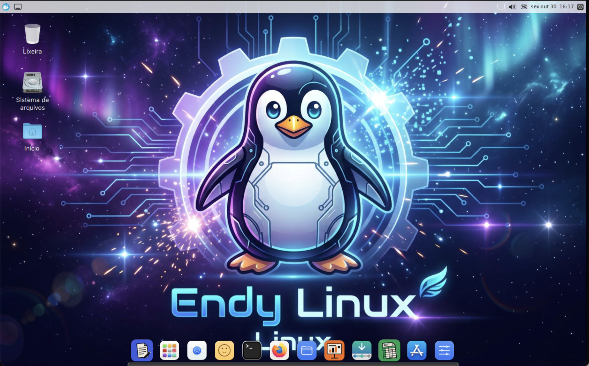

# Endy Linux
<p align="center"></p>

A lightweight, macOS-styled Linux distribution that gives old MacBooks a second life.

Built on **Debian 12 (bookworm)** + **Xfce** + the **WhiteSur** theme + the **Plank** dock + a **rofi** Spotlight-style launcher. It produces a live and installable ISO (via Calamares), built with **live-build** inside Docker.

> Repository name: `macbookos`. ISO name: `MacBookOS-amd64.iso`.

## Highlights

- macOS look and feel: WhiteSur theme, Plank dock, Spotlight (rofi), launchpad (`endy-launchpad`).
- Light enough for old MacBooks (Xfce, PipeWire, `zram-tools`, `tlp`, `thermald`, `mbpfan`).
- Working Broadcom Wi-Fi (`firmware-b43-installer`, `wpasupplicant`).
- Boots on BIOS and **64-bit EFI**, with workarounds for Apple firmware.
- Graphical **Calamares** installer, defaulting to the `America/Sao_Paulo` time zone.
- English (US) by default, with pt-BR locale and language packs (Firefox, Thunderbird, hunspell) available.
- Media codecs, VLC, mpv, Flatpak + GNOME Software, Thunderbird.
- Optional **face unlock** with OpenCV (`endy-face setup`).
- **Endy**: a terminal AI agent (`endy`) that installs Claude Code on first run (needs internet and a login or `ANTHROPIC_API_KEY`).
- Craft apps: WordCraft, DeckCraft, GridCraft and PDFCraft (`.deb` packages, sha256-verified).
- Clock synced with `chrony` (a.ntp.br), since the RTC on Macs is often wrong.

## Test hardware

MacBook Air with a Broadcom BCM43224 Wi-Fi chip, 64-bit EFI and a US keyboard.

## Download

Download the prebuilt ISO (`MacBookOS-amd64.iso`) from the [Releases page](https://github.com/uiraribeiro/endylinux/releases/tag/1.21), together with its checksum file (`MacBookOS-amd64.iso.sha256`).

```bash
shasum -a 256 -c MacBookOS-amd64.iso.sha256
```

## Write to a USB stick

```bash
# macOS (replace diskN with your USB stick; check with `diskutil list`)
diskutil unmountDisk /dev/diskN
sudo dd if=MacBookOS-amd64.iso of=/dev/rdiskN bs=4m status=progress
```

Or use balenaEtcher. On the Mac, hold **Option (⌥)** at startup and pick the **EFI Boot** disk.

## Installing

1. Boot from the USB stick and open the installer from the **Install** shortcut (it runs `endy-install`).
2. In Calamares, pick the **English (US)** keyboard (the default is Portuguese, Brazil).
3. **Warning:** Calamares **erases the disk** when you click "Install". Back up your data first.

## Building the ISO

Requirements: Docker. Works on Apple Silicon through amd64 emulation.

```bash
./build.sh
```

The script builds an image from `builder/Dockerfile`, runs a privileged container and produces `output/MacBookOS-amd64.iso` (+ `.sha256`).

- A cold build takes hours. With the `macbookos-lbcache` Docker volume (bootstrap + package cache) it takes about 40 minutes.
- `builder/build-iso.sh` copies `/src/config` at startup, so config edits made mid-build are **not** picked up. Restart the build.
- Never edit `build.sh` or `builder/build-iso.sh` while a build is running (bash reads scripts incrementally and will corrupt it).
- To stop only this project's build: `docker ps -q --filter ancestor=macbookos-builder | xargs docker kill`.
- After a build, save the result as `MacBookOS-amd64-buildNN.iso`, because `MacBookOS-amd64.iso` is always overwritten.

## Layout

```
build.sh                 # build entry point (Docker)
builder/                 # Dockerfile and build-iso.sh (live-build)
config/
  package-lists/         # macbookos.list.chroot: all packages
  hooks/normal/          # 0100-whitesur, 0150-crafts, 0160-face, 0200-system
  includes.chroot/       # files copied into the image (skel, endy-*, calamares, lightdm, plank)
  bootloaders/           # bootloader templates (grub-pc is also used for EFI)
output/                  # generated ISO and checksums
```

> APT Recommends are turned off: anything that is only a Recommends must be listed explicitly in `macbookos.list.chroot`.

## Testing in QEMU (Apple Silicon host)

```bash
qemu-system-x86_64 -machine q35 -cpu Haswell -smp 2 -m 3072 -accel tcg,thread=multi \
  -drive if=pflash,format=raw,readonly=on,file=/opt/homebrew/share/qemu/edk2-x86_64-code.fd \
  -drive if=pflash,format=raw,file=/tmp/q/vars.fd \
  -drive file=/tmp/q/disk.qcow2,if=virtio,format=qcow2 \
  -drive file=/tmp/q/test.iso,media=cdrom,if=none,id=cd0,readonly=on -device ide-cd,drive=cd0,bootindex=0 \
  -device qemu-xhci -device usb-tablet -device virtio-net-pci,netdev=n0 -netdev user,id=n0 \
  -vga std -display none -qmp unix:/tmp/q/qmp.sock,server=on,wait=off
```

Notes:

- `vars.fd` is a copy of `edk2-i386-vars.fd`.
- Use `-cpu Haswell` (with `max` the Calamares slideshow crashes) and `-smp 2` (with 8, systemd freezes).
- Boot takes about 5 minutes; a full install takes 3+ hours under TCG, so only test up to "Unpacking image".

## Lessons learned

- **No Wi-Fi**: `wpasupplicant` was missing (NetworkManager only recommends it).
- **Battery tray icon**: needs `xfce4-power-manager-plugins`.
- **Installer**: needs `squashfs-tools rsync dosfstools parted gdisk e2fsprogs efibootmgr grub-efi-amd64 grub-pc-bin` in the live image.
- **`pkexec` silently does nothing in Xfce** (no polkit agent), so `endy-install` uses `sudo -E`.
- **Apple EFI**: GRUB's graphical terminal (gfxterm) garbles the screen; on EFI, `config.cfg` forces `terminal_output console`, and Calamares sets `installEFIFallback: true`.
- **Xfce wallpaper** is stored per monitor name; `endy-wallpaper` applies it to every output.
- **Xfce shortcuts** only fire with `override=true`; Cmd = Ctrl via `altwin:ctrl_win`.

## Not yet verified on real hardware

Wi-Fi tray icon, battery %, touchpad/audio/Bluetooth, face unlock with a real camera, Craft apps rendering (needs GL/Vulkan), installer steps after the file copy (user, GRUB, first boot) and the `endy` wrapper.

## License

This project is licensed under the **GNU General Public License v3.0**. See [LICENSE](LICENSE).

Third-party components (Debian, Xfce, WhiteSur, Plank, rofi, Calamares, etc.) keep their own licenses.
